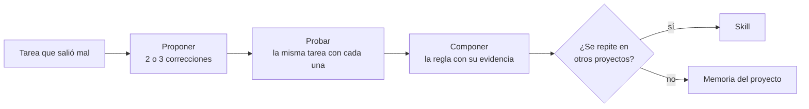

# Nexarm — Procesos

Fecha: 2026-11-22. Se apoya en [`ARQUITECTURA.md`](ARQUITECTURA.md) y [`nexarm/README.md`](nexarm/README.md).

Este documento explica cómo se trabaja el proyecto: el camino de cada acción, el reparto del
trabajo y la forma en que un tropiezo se convierte en una regla comprobada.

## 1. El camino de una acción

Cada llamada pasa por la pasarela en siete pasos:

1. **Identificar** al agente: token fijo u OAuth 2.1 con PKCE.
2. **Autorizar**: rol (`lector`, `operador`, `admin`) y permiso fino por herramienta.
3. **Validar** los datos de la llamada.
4. **Evaluar políticas**: monto, frecuencia, horario y campos restringidos. Un bloqueo gana a una aprobación.
5. **Esperar a una persona** si una política lo pide. Decide un supervisor en la consola; la solicitud vence a las 24 horas.
6. **Ejecutar** como el agente que la pidió.
7. **Registrar** en el libro de auditoría, encadenado con hash.

El agente recibe `ejecutado`, `pendiente` o `denegado`.

## 2. Quién hace qué

| Capa | En Nexarm |
|---|---|
| 1 Orquestador | La sesión del agente de código, con la memoria del proyecto |
| 2 Fuentes de verdad | Base PostgreSQL, libro de auditoría y documentos en git |
| 3 Trabajadores | Agentes `prospeccion`, `calificacion`, `seguimiento` y las entradas de Chatwoot y XENCRM |
| 4 Flujos automáticos | `NEXARM_AGENTES_AUTO=1`: cada mensaje entrante despierta a los agentes de venta |
| 5 Subagentes | Barridos amplios en paralelo, con un verificador que intenta refutar cada hallazgo |
| 6 Salidas | `message_send` por correo o WhatsApp, con aprobación de una persona |

## 3. Mejorar el arnés

El arnés es lo que rodea al modelo: instrucciones, reglas, memoria, skills, guías de herramientas
y scripts. Cuando una tarea sale mal se corrige el arnés.

| Pieza del arnés | Dónde vive |
|---|---|
| Rol e instrucciones | `nexarm/src/sales/agents.ts` |
| Reglas de freno | `nexarm/src/gateway.ts`, `nexarm/src/policies.ts` |
| Memoria | Carpeta de memoria del proyecto, un archivo por hecho |
| Skills | `~/.claude/skills/xentris-*` |
| Guía de herramientas | `nexarm/src/tools.ts` |
| Scripts | `pnpm seed`, `pnpm test`, `pnpm libro`, `pnpm agente` |
| Subagentes | `~/.claude/agents/` |
| Ganchos de sesión | `settings.json` |

Una corrección entra solo si dos ejecuciones muestran la diferencia. Cada lección lleva cuatro
campos: señal, lección, evidencia y veredicto (`ayudó`, `empeoró`, `sin efecto`, `confundido`).

## 4. Lecciones registradas

Salen de revisar todos los errores de herramienta del proyecto, del 10 al 22 de noviembre de 2026.

### Archivos largos se escriben con la herramienta de archivos
- **Señal:** hay que crear o reemplazar un archivo de más de cien líneas desde la terminal.
- **Lección:** usar la herramienta de escritura de archivos, no un heredoc.
- **Evidencia:** el 11 de noviembre tres heredocs largos (`db.ts`, `tools.ts`, `schema.sql`) terminaron en `unexpected EOF`; los tres archivos entraron con la herramienta de escritura. El 22 de noviembre tres heredocs cortos con barras invertidas, comillas simples y las dos juntas pasaron: la causa no son esos caracteres.
- **Veredicto:** ayudó

### Leer antes de editar fuera de la carpeta de trabajo
- **Señal:** se edita un archivo fuera de `nexarm/`: la raíz del repositorio, otra carpeta o una skill.
- **Lección:** leer el archivo antes de editarlo.
- **Evidencia:** el 14, el 16 y el 22 de noviembre la edición fue rechazada en `marca-xencrm/`, `video-demo/` y una skill; tras leer el archivo, la misma edición entró.
- **Veredicto:** ayudó

### El puerto sigue ocupado tras detener una tarea
- **Señal:** se detiene una tarea de fondo que arrancó un servidor con `pnpm` en Windows y hay que volver a usar su puerto.
- **Lección:** buscar el dueño con `Get-NetTCPConnection -LocalPort <puerto>` y cerrar ese proceso antes de arrancar.
- **Evidencia:** puerto 3099. Tras detener la tarea, el arranque nuevo salió con `EADDRINUSE`; tras cerrar el proceso dueño del puerto, respondió 200.
- **Veredicto:** ayudó

### La foto de celular sale recortada
- **Señal:** captura con Chrome sin ventana a menos de 500 px de ancho.
- **Lección:** pedir `--window-size=500,1080`.
- **Evidencia:** la portada a 430 px salió cortada por la derecha; a 500 px salió completa.
- **Veredicto:** ayudó

### El resultado de una herramienta viene dentro de `data`
- **Señal:** un script lee la respuesta de una herramienta MCP de Nexarm.
- **Lección:** la respuesta es `{outcome, data}`; el embudo está en `data.pipelines` y el identificador en `data.id`.
- **Evidencia:** el script de carga falló al leer `pipeline.stages`; con `data.pipelines[0]` cargó 4 empresas, 5 contactos y 5 tratos.
- **Veredicto:** ayudó

### Las páginas sueltas de XENCRM no se abren por el servidor local
- **Señal:** hace falta ver una página de la carpeta `public` de XENCRM en local.
- **Lección:** abrir el archivo con `file:///`. Las rutas vivas son `/`, `/chat` y `/admin`.
- **Evidencia:** `localhost:3000/inicio.html` respondió 404; el archivo abierto desde el disco se vio completo.
- **Veredicto:** ayudó

### Cambiar `GATE_ENGINE` no cambia el clasificador de la demo
- **Señal:** el asistente de XENCRM contesta «fuera de alcance» a un mensaje que pide cotizar.
- **Lección:** mientras `LLM_ENGINE` fuerce un solo motor, `GATE_ENGINE` no se aplica. El ajuste va en `LLM_ENGINE` o en el clasificador.
- **Evidencia:** el 22 de noviembre, el mismo mensaje con `GATE_ENGINE=openai` y con `GATE_ENGINE=ollama`: en las dos el arranque mostró `gate ollama` y la intención fue `fuera_de_alcance`.
- **Veredicto:** sin efecto. El clasificador local marca una cotización como fuera de alcance; se trabaja en XENCRM.

## 5. Trabajo grande

Explorar, descomponer, paralelizar, verificar, sintetizar. Un reparto grande se propone y una
persona lo confirma. Publicar, pagar o enviar a terceros lo decide una persona.

## 6. Dónde se guarda cada lección

| Si la lección… | Va en |
|---|---|
| Es de un solo proyecto | La memoria del proyecto y este documento |
| Se repite entre proyectos | Una skill |
| Aplica a toda sesión | Las instrucciones de arranque; al agregar una línea se recorta otra |
| Tiene una sola prueba detrás | Se anota como `confundido` y espera otra prueba |
