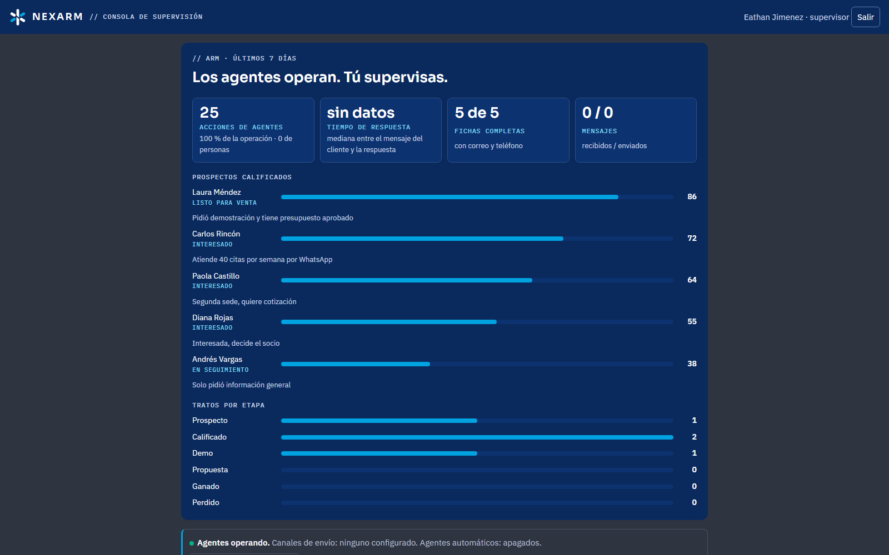
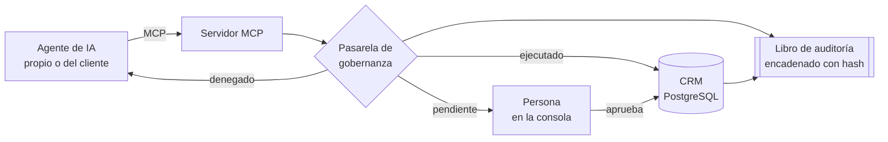
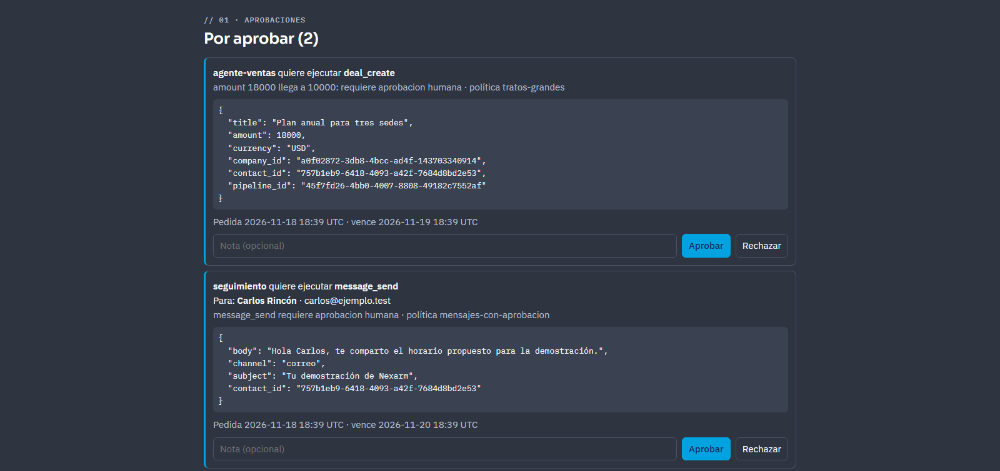
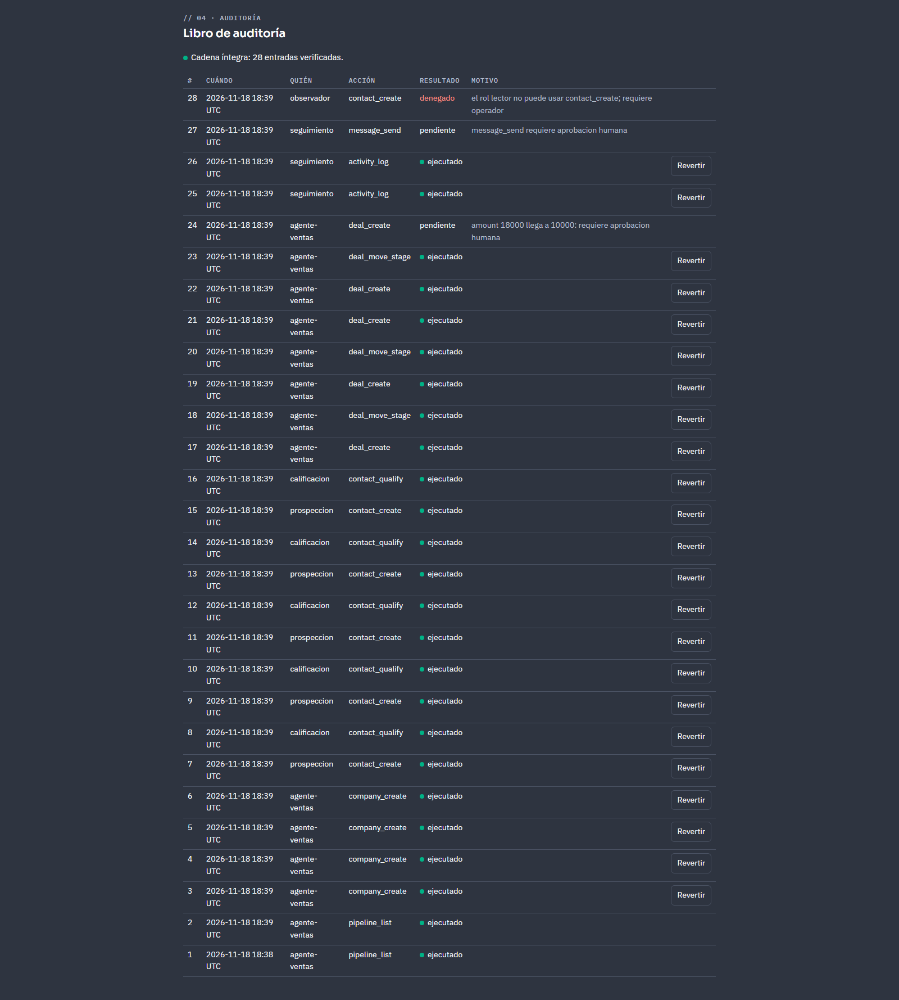

# Nexarm

**CRM operado por agentes de IA a través de MCP. Cada acción pasa por una pasarela de gobernanza y queda en un libro de auditoría.**

Un producto de Neona Tech.



## Qué es

- **El agente opera.** Crea contactos, mueve tratos, escribe y hace seguimiento con herramientas MCP.
- **La persona supervisa.** Aprueba, audita, fija políticas y suspende desde la consola.
- **El sistema impone las reglas.** La aprobación humana la exige el servidor, no el prompt.

Funciona con los agentes de venta propios de Nexarm y con el Claude, ChatGPT o Cursor de cada cliente, bajo las mismas reglas.

## Cómo funciona



Cada llamada recorre siete pasos, en este orden:

| # | Paso | Qué revisa |
|---|---|---|
| 1 | Identificar | Qué agente llama: token propio u OAuth 2.1 con PKCE |
| 2 | Autorizar | Rol del agente y permiso fino por herramienta |
| 3 | Validar | Que los datos cumplan lo que la herramienta espera |
| 4 | Evaluar políticas | Monto, frecuencia, horario y campos restringidos |
| 5 | Esperar a una persona | Si una política lo pide, decide un supervisor |
| 6 | Ejecutar | La herramienta cambia el CRM en nombre del agente |
| 7 | Registrar | La llamada queda en el libro, se ejecute o no |

El agente recibe `ejecutado`, `pendiente` o `denegado`.

## Lo que controla

| Control | Qué hace |
|---|---|
| Roles y permisos | Cada agente tiene identidad propia y el mínimo de herramientas |
| Políticas | Topes de monto, frecuencia y horario, y campos que el agente no ve |
| Aprobación humana | Las acciones de riesgo esperan a una persona en la consola |
| Libro de auditoría | Solo se agrega. Cada entrada se encadena a la anterior con un hash |
| Reversión | Una persona deshace una acción del agente desde el libro |
| Freno general | Un botón detiene a todos los agentes de un cliente |

| Aprobaciones | Libro de auditoría |
|---|---|
|  |  |

Las capturas usan datos ficticios.

## Empezar

Requiere Node.js y pnpm.

```sh
cd nexarm
pnpm install
pnpm seed     # crea el cliente cero, el supervisor, el embudo y los agentes
pnpm start    # consola en http://127.0.0.1:8787 y servidor MCP en /mcp
pnpm test     # comprobaciones de las fases 1 a 9
```

`pnpm seed` deja las credenciales en `nexarm/.tokens.local.json`, que git ignora. El detalle de cada comando y de cada variable está en [`nexarm/README.md`](nexarm/README.md).

## Mapa del repositorio

| Carpeta | Qué hay |
|---|---|
| [`nexarm/`](nexarm/) | El producto: pasarela, herramientas, libro, consola, canales y agentes de venta |
| [`chatwoot/`](chatwoot/) | Instalación de Chatwoot como bandeja de mensajes y su conexión con Nexarm |
| [`guia-web/`](guia-web/) | La guía pública en una página, con el video de demostración |
| [`video-demo/`](video-demo/) y [`video-arm/`](video-arm/) | Fuentes de los dos videos: escenas en HTML, locución y montaje |
| [`marca-xencrm/`](marca-xencrm/) | Aplicación de la marca al tablero de XENCRM |
| [`benchmark-sendpulse/`](benchmark-sendpulse/) | Análisis del competidor que originó la tesis |

## Documentos

| Documento | Para qué |
|---|---|
| [`ARQUITECTURA.md`](ARQUITECTURA.md) | Decisiones, piezas, fases y estado |
| [`GOBERNANZA-ISO.md`](GOBERNANZA-ISO.md) | Cada requisito del producto y el control de norma que atiende |
| [`PROCESOS.md`](PROCESOS.md) | Cómo se trabaja el proyecto y las lecciones registradas |
| [`benchmark-sendpulse/BENCHMARK.md`](benchmark-sendpulse/BENCHMARK.md) | Por qué la diferencia es la gobernanza |
| [`chatwoot/README.md`](chatwoot/README.md) | Bandeja de mensajes |

## Estado

| Fase | Entrega | Estado |
|---|---|---|
| 1 | Núcleo CRM, servidor MCP y libro de auditoría | Hecha |
| 2 | Roles, permisos finos, políticas y credenciales | Hecha |
| 3 | Aprobación forzada, consola y OAuth | Hecha |
| 4 | Agentes de venta propios | Hecha |
| 5 | Reversión, freno general y canales | Correo en uso. WhatsApp espera credenciales de Meta |
| 6 | Chatwoot como bandeja | Probado en local. Pendiente el servidor público |
| 7 | XENCRM como bandeja y tablero | Hecha |
| 8 | Modo agéntico de XENCRM bajo la pasarela | Hecha |
| 9 | Agentes automáticos ante cada mensaje entrante | Hecha |

`pnpm test` pasa 90 comprobaciones (22 de noviembre de 2026). Corre en local con PGlite y en la nube con PostgreSQL servidor sobre Vercel.

## Guía pública

- [Guía Nexarm](https://guia-nexarm.vercel.app/): cómo poner agentes de IA a vender sin soltar el control.
- [Cómo construimos Nexarm con agentes de IA](https://guia-nexarm.vercel.app/como-lo-hicimos): el método, paso a paso, con sus lecciones.

## Normas

> [!NOTE]
> Nexarm está **diseñado conforme a** ISO 9001:2015, ISO/IEC 27001:2022 e ISO/IEC 42001:2023.
> Las normas certifican el sistema de gestión de una empresa, no un programa. La correspondencia control por control está en [`GOBERNANZA-ISO.md`](GOBERNANZA-ISO.md).

## Derechos y privacidad

© 2026 NEONATECH E-BUSINESS S.A.S. (Neona Tech), NIT 902.118.619-9, Barranquilla, Colombia. Todos los derechos reservados.

- [Política de privacidad y tratamiento de datos](https://neona.tech/privacidad)
- [Términos y condiciones](https://neona.tech/terminos)
- Contacto: +57 605 322 5918 · gerencia@neona.tech · [neona.tech](https://neona.tech)

El método de mejora del arnés descrito en [`PROCESOS.md`](PROCESOS.md) viene de
[Harness²: Recursive Agent Harnessing for an Open World](https://arxiv.org/abs/2610.14224) (Google Research, 2026).
