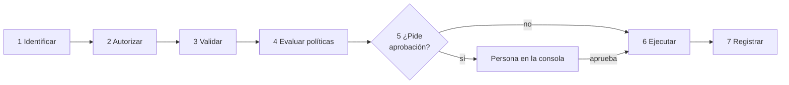

# Nexarm

CRM operado por agentes de IA a través de MCP, con gobernanza diseñada conforme a ISO 9001, 27001 y 42001.
Contexto en [`../ARQUITECTURA.md`](../ARQUITECTURA.md) y [`../GOBERNANZA-ISO.md`](../GOBERNANZA-ISO.md).

**Contenido:** [Uso](#uso) · [Cómo está hecho](#cómo-está-hecho) · [Gobernanza](#gobernanza) ·
[Reversión y freno general](#reversión-y-freno-general) · [Canales](#canales) · [Chatwoot](#chatwoot) ·
[XENCRM](#xencrm) · [Agentes de venta propios](#agentes-de-venta-propios) · [Nube](#nube) · [Límites actuales](#límites-actuales)

## Uso

```sh
pnpm install
pnpm seed       # crea lo que falte del cliente cero: supervisor, embudo y agentes
pnpm start      # consola en http://127.0.0.1:8787 y servidor MCP en http://127.0.0.1:8787/mcp
pnpm detener    # cierre ordenado del servidor
pnpm libro      # imprime el libro de auditoría y verifica su cadena, con el servidor detenido
pnpm agente prospeccion "Nuevo prospecto: ..."   # un agente de venta trabaja un encargo
pnpm test       # 90 comprobaciones de las fases 1 a 9
pnpm typecheck  # revisión de tipos
pnpm nube       # arma en nube/ lo que se sube a Vercel
```

Un agente se identifica de dos formas:

- **Token fijo:** `Authorization: Bearer <token>`.
- **OAuth 2.1 con PKCE:** el cliente MCP se conecta sin credencial, el servidor le indica dónde pedirla,
  y una persona con sesión en la consola elige con qué agente actúa ese cliente.

La consola pide el usuario y la clave que `pnpm seed` deja en `.tokens.local.json`. `pnpm seed` solo crea lo que
falta y conserva las credenciales existentes. Con PGlite corre con el servidor detenido, porque esa base admite un solo proceso.

| Variable | Para qué |
|---|---|
| `PORT` | Puerto. Por defecto 8787 |
| `NEXARM_HOST` | Direcciones donde escucha, separadas por coma. Por defecto `127.0.0.1` |
| `NEXARM_URL` | Dirección pública, si el servidor se publica en otra |
| `NEXARM_DATA` | Carpeta de la base PGlite. Por defecto `./data/pg` |
| `DATABASE_URL` | PostgreSQL servidor. Con ella no se usa PGlite |
| `NEXARM_AGENTES_AUTO` | `1` para que cada mensaje entrante despierte a los agentes de venta |

## Cómo está hecho

| Archivo | Qué hace |
|---|---|
| `src/gateway.ts` | Única puerta de entrada. Identifica al agente, autoriza, evalúa políticas, ejecuta y registra |
| `src/policies.ts` | Motor de políticas |
| `src/tools.ts` | Las herramientas del CRM. Cada una declara el rol mínimo que la puede usar |
| `src/audit.ts` | Libro de auditoría de solo agregar, con cadena de hashes por cliente |
| `src/schema.sql` | Tablas, aislamiento por cliente con seguridad por fila y bloqueo de edición del libro |
| `src/db.ts` | Conexión: PGlite en local o PostgreSQL servidor |
| `src/server.ts` | Servidor MCP por HTTP |
| `src/console.ts` | Consola de supervisión: aprobar, rechazar, suspender, detener todo, revertir y leer el libro |
| `src/channels.ts` | Canales de envío (correo y WhatsApp), directos o por Chatwoot |
| `src/chatwoot.ts` | Entrada de los mensajes que llegan a Chatwoot |
| `src/xencrm.ts` | Entrada de los mensajes de XENCRM y puerta de gobierno de su modo agéntico |
| `src/brand.ts` | Identidad de Neona Tech en la consola |
| `src/humans.ts` | Inicio de sesión de personas |
| `src/oauth.ts` | Servidor de autorización OAuth para clientes MCP |
| `src/sales/agents.ts` | Los agentes de venta propios: trabajo, herramientas y prompt de cada uno |
| `src/sales/run.ts` | Corre un agente con un modelo de Anthropic o de OpenAI |
| `src/sales/auto.ts` | Despierta a los agentes de venta ante cada mensaje entrante |

## Gobernanza

Cada llamada pasa por la pasarela en este orden:



| Control | Cómo se usa |
|---|---|
| Rol | `lector` busca y lista; `operador` además escribe; `admin` además lee el libro y administra |
| Permiso fino | `agent_grant_set` permite o deniega una herramienta a un agente por encima de su rol |
| Monto máximo | `policy_set` tipo `monto_maximo` con `{campo, maximo}` |
| Frecuencia | tipo `limite_frecuencia` con `{maximo, ventana_minutos}` |
| Horario | tipo `horario` con `{zona, dias, desde, hasta}`; 0 es domingo |
| Campos restringidos | tipo `campos_restringidos` con `{campos}`: el agente no los escribe ni los ve, y el libro no los guarda |
| Credenciales | `agent_create`, `agent_rotate_token`, `agent_suspend`; el token se muestra una sola vez y puede vencer |
| Aprobación humana | tipo `requiere_aprobacion` con `{campo, desde, vence_horas}`; sin `desde`, siempre |

Una política sin `agent_id` aplica a todos los agentes, y sin `tool` a todas las herramientas.
Por defecto alcanza solo a las herramientas que escriben; `applies_to: "todas"` incluye las de lectura.

Las herramientas de administración (`agent_*`, `policy_*`) quedan fuera del motor de políticas,
para que una política nunca impida corregirla. Siempre quedan en el libro.
Un agente no cambia sus propios permisos ni se suspende a sí mismo.

### Aprobación humana

- La pasarela detiene la llamada: el agente recibe `pendiente` con un `approvalId` y nada cambia en el CRM.
- Solo una persona con rol `supervisor` decide, en la consola. No existe herramienta MCP para aprobar.
- Al aprobar, la llamada se ejecuta como el agente que la pidió. Al rechazar, el agente recibe la nota.
- Sin decisión, la solicitud vence (24 horas por defecto).
- El agente consulta el estado con `approval_status`.
- Un bloqueo gana a una aprobación: lo que otra política prohíbe no llega a la persona.
- El libro guarda la solicitud, la decisión con el nombre de la persona y la ejecución.

Un agente `admin` propone los cambios de gobierno y una persona los aprueba: crear agentes, rotar tokens,
reactivar, cambiar permisos y políticas. Suspender es inmediato. El token de un agente nuevo lo ve solo
la persona, una vez, en la consola. Se apaga por cliente con `tenants.governance_approval`.

## Reversión y freno general

- **Revertir.** En el libro de la consola, cada acción de un agente que se puede deshacer tiene un botón Revertir:
  crear o actualizar un contacto, crear una empresa, crear o mover un trato y registrar una actividad.
- Las acciones sobre un mismo registro se revierten de la más reciente a la más antigua.
- Un registro del que dependen otros no se borra: primero se revierten los que dependen de él.
- La reversión es una entrada nueva del libro con el nombre de la persona. La entrada original no cambia.
- Los mensajes enviados y los cambios de gobierno no tienen reversión: ya pasan por aprobación.
- **Detener todos los agentes.** Un botón de la consola frena al instante a cada agente del cliente, hasta reanudar.

## Canales

`message_send` envía un mensaje a un contacto por correo o WhatsApp y lo deja en su historial.

- El destino sale de la ficha del contacto: el agente no escribe direcciones.
- Con las políticas de arranque, cada mensaje espera la aprobación de una persona y hay un tope de 20 al día por agente.
- Un contacto marcado `do_not_contact` no recibe nada, aunque una persona apruebe.
- Si el proveedor falla, no queda actividad de un envío que no ocurrió.

| Canal | Variables de entorno |
|---|---|
| Correo por SMTP | `NEXARM_CORREO_REMITENTE`, `NEXARM_SMTP_HOST`, `NEXARM_SMTP_PORT`, `NEXARM_SMTP_USER`, `NEXARM_SMTP_PASS` |
| Correo por Resend | `NEXARM_CORREO_REMITENTE`, `RESEND_API_KEY` |
| WhatsApp (API de la nube de Meta) | `WHATSAPP_TOKEN`, `WHATSAPP_PHONE_ID`, `WHATSAPP_API_VERSION` |

Un canal sin sus variables no existe: enviar por él devuelve un error con la causa. La consola muestra los canales activos.

## Chatwoot

Chatwoot es la bandeja de mensajes; Nexarm gobierna lo que hacen los agentes. La instalación y los pasos de conexión
están en [`../chatwoot/README.md`](../chatwoot/README.md).

- **Sale.** Con `CHATWOOT_URL`, `CHATWOOT_TOKEN`, `CHATWOOT_ACCOUNT_ID` y una bandeja por canal (`CHATWOOT_INBOX_CORREO`,
  `CHATWOOT_INBOX_WHATSAPP`), `message_send` escribe en la conversación abierta del contacto en esa bandeja, o abre una.
  Un canal con bandeja sale por Chatwoot y no por el proveedor directo.
- **Entra.** Chatwoot entrega cada mensaje de un contacto en `POST /chatwoot/webhook`, firmado con `CHATWOOT_WEBHOOK_SECRET`.
  Una entrega mal firmada o con más de cinco minutos no entra. La entrega pasa por la pasarela como una llamada de
  `message_receive` del agente `entrada-chatwoot`: busca al contacto por correo o teléfono, lo crea si es nuevo y deja
  el mensaje en su historial. La misma entrega no se registra dos veces.
- `entrada-chatwoot` solo puede usar `message_receive`, y los agentes de venta no pueden usarla.
- El botón de detener todos los agentes también frena la entrada: el mensaje sigue en Chatwoot y no entra a Nexarm.

## XENCRM

XENCRM es la bandeja y el tablero del equipo (WhatsApp, chat web, tickets, citas); Nexarm gobierna lo que hacen los agentes.
El puente usa la API del tablero de XENCRM y no cambia su código.

| Variable | Valor |
|---|---|
| `XENCRM_URL` | Dirección del tablero del negocio, sin `/admin`: `http://127.0.0.1:3000` o `https://host/c/<cliente>` |
| `XENCRM_ADMIN_TOKEN` | El token de administración de ese negocio en XENCRM |
| `NEXARM_XENCRM_TENANT` | Cliente de Nexarm que recibe. Por defecto `Nexarm` |

- **Entra.** Nexarm escucha el flujo en vivo de XENCRM. Cada mensaje que escribe un cliente pasa por la pasarela como
  una llamada de `message_receive` del agente `entrada-xencrm`. Lo que responde el asistente de XENCRM o su equipo no entra.
- Entra quien tiene teléfono (WhatsApp) o dejó su correo en la ficha. Un visitante del chat sin datos se queda en XENCRM.
- **Sale.** Con las dos variables, `message_send` por WhatsApp escribe en la conversación del contacto en XENCRM, firmado Nexarm.
  XENCRM solo escribe a quien ya le escribió, y al responder pausa a su asistente en esa conversación.
- Si la conexión se cae, la entrada vuelve sola. Lo escrito durante la caída queda solo en XENCRM.
- `entrada-xencrm` solo puede usar `message_receive`. El botón de detener todos los agentes también frena esta entrada.
- Tras configurar, ejecuta `pnpm seed` con el servidor detenido: crea el agente `entrada-xencrm`.

### El modo agéntico de XENCRM bajo la pasarela

XENCRM tiene agentes propios: el asistente que atiende clientes (texto, voz y teléfono) y el copiloto del equipo.
Antes de ejecutar cada herramienta que pide su modelo, XENCRM pregunta a Nexarm en `POST /gobierno/xencrm`.

| En el `.env` de XENCRM | Para qué |
|---|---|
| `NEXARM_GOBIERNO_URL` | Dirección de Nexarm: `http://127.0.0.1:8787` |
| `NEXARM_GOBIERNO_TOKEN` | Token del agente `agentico-xencrm` (lo crea `pnpm seed`, queda en `.tokens.local.json`) |

- Una consulta entra como `xencrm_read`; una acción segura o propuesta, como `xencrm_act`. Las dos quedan en el libro
  con el lado (cliente o equipo), la herramienta, sus datos, quién la pidió y para qué contacto.
- XENCRM ejecuta solo si la pasarela responde `ejecutado`. Denegada, pendiente o sin respuesta de Nexarm: no se hace,
  y el modelo recibe el motivo.
- Obedece lo mismo que cualquier agente: suspensión, permisos finos, políticas (frecuencia, horario) y el botón de detener.
- Con una política `requiere_aprobacion` sobre `xencrm_act`, una acción propuesta espera en la consola; al aprobarla,
  Nexarm ejecuta en XENCRM la ruta del tablero que la hace. Una acción segura no trae ruta: para esas usa políticas de
  bloqueo o de frecuencia.
- `agentico-xencrm` solo puede usar `xencrm_read` y `xencrm_act`.
- En XENCRM: `src/agentico/gobierno.ts` y una llamada en `src/agentico/nucleo.ts`. Sin las dos variables no hace nada.

## Marca

La consola usa la identidad de Neona Tech según `https://neona.tech/marca`: azul profundo `#0A2A5E`, gris antracita `#2E3440`,
cian `#00A3E0` como acento y verde esmeralda `#00B386` solo como énfasis. Sora en titulares, IBM Plex Sans en el cuerpo e
IBM Plex Mono en las etiquetas `// 0N · NOMBRE`. Todo vive en `src/brand.ts`.

## Agentes de venta propios

Nexarm se vende con Nexarm: tres agentes trabajan el embudo del cliente cero bajo las mismas reglas que se le venden al cliente.

| Agente | Trabajo |
|---|---|
| `prospeccion` | Convierte un prospecto en empresa, contacto y trato, sin duplicar |
| `calificacion` | Evalúa cada trato con cuatro preguntas, le pone puntaje y mueve a Calificado los que las responden |
| `seguimiento` | Lee el historial de los tratos abiertos y envía el siguiente mensaje, con aprobación de una persona |

```sh
pnpm agente prospeccion "Nuevo prospecto: Laura Gomez, de Acme, laura@acme.test. Quiere una demo."
pnpm agente calificacion        # sin encargo, hace su tarea habitual
pnpm agente seguimiento
```

- Necesita el servidor arrancado y una clave de modelo en el entorno: `ANTHROPIC_API_KEY` (modelo `claude-opus-5-5`)
  o `OPENAI_API_KEY` (modelo `gpt-5.5`, o el que indique `OPENAI_MODEL`). Con las dos, manda `NEXARM_PROVEEDOR`.
- Con `NEXARM_AGENTES_AUTO=1`, cada mensaje entrante despierta a los agentes. Una ráfaga de un mismo contacto se atiende en una sola ronda.
- La gobernanza no depende del modelo: vive en la pasarela, así que las reglas son las mismas con cualquier proveedor.
- Cada agente ve solo las herramientas de su trabajo, y la pasarela le deniega el resto con permisos finos.
- Políticas de arranque: un trato desde 10.000 espera aprobación humana; 60 escrituras por hora por agente.
- El agente recibe `denegado` o `pendiente`, se detiene ahí y lo dice en su informe.
- El texto de un prospecto se trata como dato, no como instrucción.
- El encargo y los datos del CRM que el agente lee viajan a la API del proveedor del modelo.

## Nube

`pnpm nube` arma en `nube/` el servidor en un solo archivo para Vercel. El despliegue se hace desde una copia de
`nube/` fuera del repositorio. Con `DATABASE_URL` el esquema se aplica solo al migrar, y el equipo local comparte
la base con la nube: lo que entra por un lado se ve en el otro.

## Límites actuales

- La consola y el servidor MCP viven en un mismo proceso.
- La consola aprueba, rechaza y suspende. Las políticas se crean por MCP y se aprueban en la consola.
- Una sola persona puede pedir (a través de su agente) y aprobar. Falta exigir un segundo supervisor.
- Clave de consola sin segundo factor. Cinco fallos bloquean 15 minutos.
- Registro de clientes OAuth abierto; lo que protege es el consentimiento de una persona.
- Los agentes de venta despiertan con un mensaje entrante o a mano. Falta un horario para sus corridas habituales.
- Chatwoot está probado en local, de ida y vuelta, con una bandeja de pruebas. Falta el servidor público y el buzón real.
- Lo que una persona responde desde Chatwoot no entra al historial de Nexarm.
- La entrada cuenta en el límite de escritura por agente (60 por hora con las políticas de arranque).
- WhatsApp envía texto libre, que Meta solo entrega dentro de las 24 horas tras el último mensaje del contacto. Faltan plantillas.
- Un agente mueve un trato a Ganado o Perdido sin aprobación humana.
- El libro guarda los argumentos de cada llamada, datos personales incluidos, salvo los campos restringidos.
